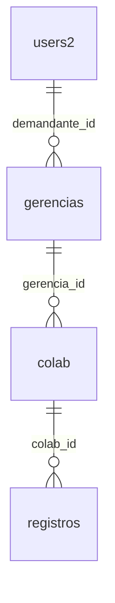

# Gestão de demandantes, gerências e profissionais

**Ativado no perfil MySQL isolado original em 27/10/2026 às 21:33, horário de São Paulo**, após autorização e escolha explícita do mapa: **Gerência de Testes → avaliador atual → ambos os profissionais**. Origem com 13 migrations, uma gerência, dois profissionais e oito avaliações preservadas. Aplicação principal retomada em **http://localhost:5173**, API **http://localhost:8001**. Contas e demais campos legados foram preservados; nenhuma conta foi criada para o responsável antigo do profissional B. [Evidências da ativação](evidencias/ativacao-gerencias/summary.json).

A confirmação do usuário definiu um demandante por gerência, várias gerências por demandante, uma gerência por profissional e arquivamento com preservação das avaliações. A implementação foi primeiro validada em cópia, como registrado abaixo; a seção final descreve a ativação posterior autorizada. Outros mapas/alvos continuam exigindo aprovação própria.

## Modelo e permissões



O booleano `users2.admin` continua distinguindo os dois perfis existentes. Administrador gerencia profissionais, demandantes e gerências; demandante consulta/avalia profissionais das gerências que lhe pertencem atualmente. Novas contas pela interface são sempre avaliadores, com senha inicial Argon2id segundo os parâmetros já existentes. O formulário não permite criar/promover administradores; a CLI administrativa existente mantém essa capacidade.

`gerencias.demandante_id` referencia a conta por ID e é a única fonte da responsabilidade atual. `colab.gerencia_id` referencia a gerência por ID. Leituras de histórico usam `registros.colab_id` → profissional → gerência → ID da conta da sessão, antes da paginação. Não há autorização pelo texto antigo de e-mail/nome. Mudanças de nome/e-mail da conta não exigem reescrever atribuições; alteram `session_version`, revogando sessões anteriores.

O administrador troca o responsável pela gerência em uma transação. O novo responsável recebe seu histórico; o anterior perde acesso nas próximas requisições, salvo se for administrador ou se o profissional tiver sido movido para outra gerência sob sua responsabilidade. A autoria em `registros.demandante`, nomes históricos, notas e datas não são reescritos. Transferir um profissional para outra gerência também transfere a visibilidade de seu histórico conforme essa gerência atual.

Arquivar profissional preenche `colab.deletedAt`: sai da seleção e não aceita novas avaliações; o histórico continua consultável conforme o responsável atual. Gerência só pode ser arquivada após transferir/arquivar seus profissionais ativos; seu responsável continua controlando o histórico dos arquivados. Demandante só pode ser excluído logicamente após reatribuir todas as suas gerências, inclusive arquivadas. Exclusão preenche `deletedAt`, desativa e revoga sessões; o e-mail da linha excluída permanece reservado pela restrição única. A própria conta administrativa e o último administrador ativo são protegidos.

## Interface

- **Demandantes** (`/demandantes`, administrador): listar/pesquisar, criar nome/e-mail/senha inicial/confirmação, editar nome/e-mail e excluir acesso com confirmação. Senhas são limpas após tentativa de envio e desmontagem; não ficam em armazenamento do navegador, respostas, logs ou exemplos. Senha inicial segue 15–128 caracteres; o responsável pode trocá-la pelo fluxo autenticado existente. Não há envio de e-mail.
- **Gerências** (`/gerencias`, administrador): listar/pesquisar, cadastrar e editar nome/demandante por seleção de conta ativa; arquivar respeitando dependências. A troca de responsável informa seu efeito no acesso ao histórico. As arquivadas permanecem listadas com situação, permitindo reatribuição antes de excluir a conta.
- **Inserir profissional** (`/inserir`): seleção de gerência disponível; demandante preenchido automaticamente e somente leitura. Nome e gerência são obrigatórios; falha/carregamento/lista vazia impedem envio. Gerências com responsável indisponível não são opções de cadastro.
- **Editar profissional** (`/editar-profissional/:id`): reaproveita o componente Options API de cadastro, com PUT pelo ID. Permite corrigir nome e demais campos, incluindo transferir a gerência; avaliações preservam seus snapshots.
- **Profissionais** (`/colabs`): editar/arquivar ativos, incluir arquivados na listagem. O seletor de avaliações recebe somente profissionais ativos.

Os controles preservam Tailwind/Flowbite, paleta, temas e modais existentes. O menu ganhou links administrativos e quebra de linha em telas intermediárias. Para evitar apresentar a exclusão física da API antiga como arquivamento, a interface só oferece ações de edição/arquivamento quando a resposta do profissional contém os metadados do modelo novo. Isso é compatibilidade visual; a autorização efetiva continua no Express.

## Vínculo obrigatório de todo profissional — reforço aplicado no perfil isolado

**Concluído após aprovação explícita em 28/10/2026 às 21:16, horário de São Paulo.** A migration `20261028000100_require_colab_gerencia.js` passou primeiro na cópia restaurada e depois na origem fictícia. Baseline atual: **14 migrations**, `colab.gerencia_id INT UNSIGNED NOT NULL`, índice/FKs restritivos preservados e nenhum vínculo ausente ou órfão, incluindo arquivados. Os dois profissionais, a gerência, as contas e as oito avaliações foram comparados integralmente e preservados. [Resumo sanitizado](evidencias/vinculo-obrigatorio/summary.json).

`EnforceProfessionalDepartment` exige o perfil original exato, confirmação `colab.gerencia_id:NOT_NULL:13->14`, cadeia completa de 13 migrations, ausência de outras conexões selecionando origem/cópia, identidade MySQL e vínculos válidos. Faz backup/restauração novos e autentica o artefato; compara todos os dados de negócio e metadados de colunas/índices/FKs, permitindo somente a nulabilidade planejada. O manifesto privado é criptografado fora do Git. Checkpoints distinguem cópia verificada, DDL da origem tentado, aplicado e verificação final. Falha interrompe sem `down` automático; backup/cópia/manifesto/checkpoint são preservados para plano próprio de recuperação.

Backup `backup-d22f7f4af567.evalbackup`, relatório `recovery-report-d22f7f4af567.json`: **9 tabelas/49 registros**, DDL/conteúdo idênticos e login de administrador/avaliador recuperado. Cópia `_restore_d22f7f4af567`: migration recusada para fixture arquivada sem gerência antes do DDL, com rollback; após aplicar, INSERT omitido/nulo, UPDATE nulo (inclusive arquivado), pais inválidos e exclusão física de pais foram recusados. HTTP real passou para cadastro, transferência, arquivamento com vínculo preservado e exclusão protegida do responsável de gerência arquivada. As três fixtures adicionais foram removidas somente da cópia, por IDs novos conferidos; os dados de negócio originais voltaram a coincidir integralmente.

A origem só recebeu a migration após nova comparação de identidade/schema/dados e ausência de escritores. HTTP autenticado de ambos os perfis passou, com leitura dos dois profissionais e oito avaliações e restrição administrativa. Sessões/contadores podem mudar nesses testes; contas/dados de negócio permaneceram iguais. API principal retomada em `localhost:8001` com `Serve` exigindo estrutura/baseline 14; frontend preservado em `localhost:5173` e MySQL em `127.0.0.1:50470`. Frontend **200**, API sem sessão **401**. Os aplicadores históricos continuam recusando baseline inesperado/repetição.

Artefatos externos preservados: `required-department-manifest-b54bf1288a79.evalinventory` e `required-department-report-b54bf1288a79.json`. **190/190 testes**, zero falhas/skips (12 novos); parser PowerShell sem erros e diff sem erros de whitespace. Frontend inalterado: build/Chrome não foram repetidos; HTTP real não é validação visual. Nenhuma dependência nova, SMTP, produção, commit/push ou deploy.

O usuário confirmou que **todo profissional deve sempre ter um demandante associado**, inclusive quando arquivado. O vínculo permanece pelo modelo existente: `colab.gerencia_id → gerencias.demandante_id → users2.id`. Não haverá um segundo responsável independente no profissional. Transferir a gerência ou mudar seu demandante mantém um responsável durante toda a operação; arquivar preserva os IDs e o histórico.

O cadastro/edição já exige gerência válida com responsável ativo. A API bloqueia excluir um demandante enquanto existir qualquer gerência vinculada, inclusive arquivada. O formulário exige a gerência e deriva o demandante. A lacuna de integridade estrutural é `colab.gerencia_id` aceitar nulo, mantido na migration 13 para a transição revisada dos legados. A ativação anterior associou os dois profissionais do perfil fictício, mas a coluna ainda permite gravação SQL direta sem vínculo. As FKs existentes já impedem referências a gerências/contas inexistentes e exclusão física desses pais enquanto referenciados.

**Plano aprovado e seguido nesta execução:**

1. Adicionar migration 14 independente, sem alterar a migration 13 já aplicada. Antes do DDL, verificar todos os profissionais, inclusive arquivados: nenhum `gerencia_id` nulo ou vínculo sem gerência/conta. Inconsistência interrompe a operação; nenhum responsável é inventado/preenchido automaticamente.
2. Tornar `colab.gerencia_id` `NOT NULL`, preservando tipo unsigned, índice e FK restritiva. Manter `gerencias.demandante_id` obrigatório/FK como hoje; os campos textuais legados continuam sem definir a responsabilidade.
3. Atualizar os validadores de versão/estrutura e o `Serve` do ambiente isolado para o baseline 14, preservando os aplicadores históricos que recusam repetição. Arquivos envolvidos: nova migration, runner de validação/ativação isolada, `backend/scripts/isolated-auth.js`, `backend/scripts/isolated-mysql.ps1`, testes de gestão/estrutura e documentação. Nenhuma alteração de autenticação ou de payload/rota é necessária.
4. Após autorização específica para o perfil fictício, suspender escritores, gerar backup criptografado atualizado e verificar restauração em nova cópia. Aplicar primeiro na cópia; testar rejeição de INSERT/UPDATE sem gerência, FKs, cadastro/transferência/arquivamento/exclusão protegida e preservação de contas/avaliações. Só após sucesso e revalidação atingir a origem isolada e retomar a API.
5. Aceitação: todos os profissionais, inclusive arquivados, mantêm gerência/demandante por ID; banco rejeita nulos/referências inválidas; transferências nunca passam por desvinculação; oito avaliações e demais dados preservados. DDL MySQL tem commits implícitos: conservar backup/checkpoints e interromper em falha; recuperação exige plano próprio, sem `down` automático.

A alternativa de manter apenas a validação da aplicação permitia nulos em SQL direto. Foi aprovado o reforço no banco, sem duplicar `demandante_id` em `colab` ou mudar os contratos. O reforço não exigiu dependências novas nem acesso a produção. `AGENTS.md`, seções 4.2 e 10, exige aprovação própria para outros alvos. Testes adicionais cobrem cadastro/edição com gerência ausente/nula/inválida e gerência com responsável ausente/inativo/excluído, verificando ausência de alterações nos dados de negócio quando recusados.

Validação histórica da confirmação inicial: **178/178 aprovados**, sem mudança estrutural naquele lote. O resultado atual do reforço aprovado é **190/190**, conforme execução acima. `EnforceProfessionalDepartment` já concluiu a transição 13→14 e recusa repetição; não usá-lo como consulta ou em outro alvo.

## Contratos da API

| Método/rota | Entrada e resultado |
| --- | --- |
| `GET /demandantes` | Administrador; ID/nome/e-mail/perfil/atividade/exclusão, sem senha/hash/versão de sessão; excluídos logicamente não aparecem. |
| `POST /demandantes` | Administrador; `{ name, email, password }`; cria avaliador ativo; 204. |
| `PUT /demandantes/:id` | Administrador; `{ name, email }`; revoga sessões, preserva perfil/senha; 204. |
| `DELETE /demandantes/:id` | Administrador; exclusão lógica após reatribuição; 204 ou 409. |
| `GET /gerencias` | Autenticado; administrador consulta todas as ativas, com `estado=todos` inclui arquivadas; demandante recebe somente suas ativas. Nome/e-mail do responsável são derivados da conta atual. |
| `POST /gerencias` | Administrador; `{ nome, demandante_id }`, responsável ativo; 204. |
| `PUT /gerencias/:id` | Administrador; mesmo corpo; pode reatribuir gerência inclusive arquivada; 204. |
| `DELETE /gerencias/:id` | Administrador; arquiva se não houver profissionais ativos; 204 ou 409. |
| `POST /colab` / `PUT /colab/:id` | Administrador; nome e `gerencia_id` válido obrigatórios, demais campos opcionais existentes. Gerência/e-mail em texto enviados pelo cliente não definem responsabilidade: valores são derivados no servidor; 204. |
| `DELETE /colab/:id` | Administrador; arquiva em vez de apagar fisicamente; 204. |
| `GET /colab` | Ativos no escopo; `estado=todos` permite ao administrador incluir arquivados. Mantém campos anteriores e acrescenta `gerencia_id`, `deletedAt`, `demandante_nome`; gerência/demandante são derivados quando vinculados. |
| `GET /colab/:id` | Ativo no escopo ou 404; arquivado não é selecionável para edição/avaliação. |

Entradas inválidas retornam 400, autenticação ausente 401, falta de permissão/origem/CSRF 403, inexistente 404 e conflito/indisponibilidade 409. Erros internos são genéricos. Novas mutações administrativas de contas/gerências usam limite de 30 operações por conta em 15 minutos, na tabela de limites existente. As rotas PUT/cadastro/arquivamento de profissional mantêm autorização administrativa e CSRF. Nenhum campo recebido concede perfil administrativo.

Consign continua carregando autenticação → middlewares → handlers → rotas. `api/management.js` expõe fábricas de handlers; serviços ficam em `lib/management.js`, fora do autoload. Nenhum pacote ou ordem de inicialização foi alterado.

### Concorrência e integridade

Operações administrativas travam administradores ativos em ordem por ID e revalidam a conta/versão da sessão na transação, compatíveis com a ordem da CLI. Responsável e gerência são revalidados antes da gravação. A gravação de avaliação trava a conta autora, obtém candidato no escopo por ID, trava a gerência para leitura e relê/trava o profissional, conferindo gerência/arquivamento antes de inserir. Uma transferência concorrente concluída enquanto a gravação aguarda o lock provoca 403 para o antigo responsável, sem inserção. O corpo não escolhe o autor.

Leituras de profissionais fazem consultas em lote para derivar os nomes/e-mails atuais, sem uma consulta por linha. A consulta SQL de autorização ocorre antes de carregar dados e paginar; Vue não refiltra o histórico por autor.

## Migration e planejamento da transição

`20261027000100_add_management_departments.js`:

1. Recusa qualquer avaliação ainda com `colab_id` nulo, antes de DDL.
2. Cria `gerencias` com ID, nome, responsável por FK para `users2`, arquivamento e timestamps.
3. Adiciona `colab.gerencia_id` nullable, índice/FK e `deletedAt` nullable. Nulabilidade é apenas a transição para preservar os cadastros; novos cadastros pela API exigem gerência válida.
4. Retira a FK textual `registros.colab → colab.colab`, mantendo o vínculo por ID restritivo e o texto histórico. Isso permite corrigir nomes sem alterar avaliações.

Não cria gerências a partir de textos, não resolve e-mails e não preenche IDs automaticamente. Profissionais legados sem `gerencia_id` e seus históricos ficam administrativos até associação revisada. Os textos antigos de gerência/demandante são preservados; `colab.demandante` é compatibilidade legada, não fonte de permissão. O `down` recusa destruição automática. DDL MySQL pode ter commits implícitos; rollback da aplicação não reverte essa migration.

**Plano seguido na ativação da origem isolada:** inventariar/revisar gerências/contas/profissionais, obter confirmação específica, fazer backup/restauração atualizados, suspender escritores, testar primeiro em cópia nova, verificar estrutura/preservação, aplicar schema/mapa e reiniciar a API. A origem já possui a estrutura nova; outros ambientes com 12 migrations não podem executar este código sem sua transição aprovada.

Em falha, preservar backup/cópia/relatórios e analisar recuperação em cópia separada. Não executar `down`, apagar gerências ou restabelecer autorização por autor/e-mail como atalho. Outros ambientes exigem inventário, plano e autorização próprios.

## Validação inicial MySQL na cópia

`isolated-mysql.ps1 -Action ValidateManagement` verifica o perfil fictício autorizado/UUID/diretório/porta/bind/marcador e baseline 12. Compartilha locks de leitura das três tabelas de negócio durante o dump, permitindo as escritas técnicas de sessões do processo local anterior. Não há DDL/DML na origem. `mysqldump --single-transaction` gera backup AES-256-GCM autenticado, com chave de recuperação do cofre DPAPI; arquivo de opção temporário protegido é removido no finally. Cria namespace `_mgmt_<id>` novo e recusa destino existente, triggers/rotinas/eventos e volume fora dos limites do runner. Dados de negócio e DDL da restauração são comparados; sessões/limites do dump são um snapshot técnico, sem promessa de igualdade com as escritas concorrentes da origem.

Somente na cópia, concede privilégios isolados, exige 12 migrations concluídas e exclusivamente a 13ª pendente, aplica-a e verifica que não houve associação automática. Fixtures explícitas do runner criam duas gerências fictícias e associam os dois profissionais somente na cópia. Os cenários criam/editam/excluem logicamente conta fictícia adicional, transferem gerências, corrigem nome e arquivam profissional/gerência. Ao final confirma novamente dados de negócio e schema da origem intactos. Copia, backup e relatório são preservados; nenhum banco existente é restaurado ou excluído.

Execução concluída em **27/10/2026 às 20:51, horário de São Paulo**, MySQL 8.0.44:

- Origem: 12 migrations, dados de negócio/schema preservados.
- Cópia: `evaluation_isolated_0f8785e64029_v2_mgmt_5e14e8056c25`, 13 migrations.
- Backup: `management-backup-5e14e8056c25.evalbackup`; relatório: `management-report-5e14e8056c25.json`, externos.
- Oito grupos SQL/HTTP aprovados: legados administrativos, associação explícita da fixture, transferência com sessões existentes, correção de nome sem reescrever registros, espera de lock observada com gravação antiga negada, arquivamento com histórico, edição/exclusão/revogação de conta e oito avaliações originais preservadas.

## Testes, revisão visual e prévia iniciais

**170/170 testes aprovados**, zero falhas/skips: suíte Node/Vue existente adaptada ao novo contrato e 18 novos testes de gestão/formulários/barreiras do runner, incluindo retry seguro do carregamento do profissional antes de editar. DDL compilado sem conexão na suíte padrão; MySQL real somente pelo runner acima. Build development aprovado em pasta temporária, preservando `frontend/dist`. Parser PowerShell e revisão do diff conferidos. Sem nova dependência, SMTP, commit/push ou deploy.

Chrome com APIs inteiramente simuladas: **40 grupos novos** em `review-departments.mjs` e **32 de regressão** em `review-management.mjs`, todos aprovados, zero erros JavaScript. O primeiro cobre 320/390/768/1440 px em claro/escuro, com capturas e inspeção visual de desktop/celular; cadastro/edição/transferência, formulários, descarte de senhas, falhas/vazio/retry, restrição de demandante e compatibilidade com API antiga. O segundo confirma as páginas de gestão anteriores, busca, tabelas, formulário e modais. Ferramenta Playwright temporária e Chrome existentes reutilizados; nada instalado. Runners e capturas em `frontend/node_modules/.cache/`, ignorados pelo Git.

```powershell
$env:EVAL_VISUAL_TOOL_DIRECTORY = '<diretório temporário já preparado com playwright-core>'
node frontend/scripts/review-departments.mjs
node frontend/scripts/review-management.mjs
```

A prévia manual inicial usou **http://127.0.0.1:5174**, API **http://127.0.0.1:8002**, exclusivamente na cópia validada. Seus processos foram encerrados depois da ativação da aplicação principal, mas os dados permanecem. O hostname 127.0.0.1 separou cookies host-only da aplicação em localhost. Origem CORS exata da prévia: `http://127.0.0.1:5174`; mesmas regras locais HttpOnly/SameSite=Lax, sem Domain. Sessões/contas são as fictícias recuperadas, sem senha padrão ou impressão de credenciais. Testes deixaram um profissional/gerência arquivados e uma conta adicional excluída somente nessa cópia; essas fixtures não foram importadas na origem.

Para retomar a prévia já preparada, somente se as portas estiverem livres:

```powershell
$perfilAvaliacao = Join-Path $env:LOCALAPPDATA 'EvaluationDev/mysql-isolated-0f8785e64029'
./backend/scripts/isolated-mysql.ps1 -Action ServeManagementCopy -ProfileDirectory $perfilAvaliacao `
  -ManagementReportName 'management-report-5e14e8056c25.json'
# Em outro terminal:
$env:VITE_API_URL = 'http://127.0.0.1:8002'
npm --prefix frontend start -- --host 127.0.0.1 --port 5174 --strictPort
```

O launcher exige relatório de sucesso explícito, namespace correspondente, marcador e 13 migrations; nunca aponta a prévia à origem. Frontend 200, API anônima 401 e URL da API no cliente foram conferidos. Após a ativação, localhost:5173/8001 passou a oferecer as rotas novas na origem isolada. Recuperação em outro host, comportamento com volume real e auditoria durável de alterações administrativas continuam para etapas próprias.

As ações históricas `Validate` e `VisualReview` recusam execução antes de conectar ao banco: suas fixtures anteriores não contemplam gerências. `ValidateManagement`, `Inventory`, `ReconcileReviewed` e `ValidateLinks` são ferramentas de transições/baselines anteriores e não devem ser repetidas na origem já atualizada. `Serve` exige baseline 13; `ServeManagementCopy` continua disponível apenas para consultar uma cópia validada, se necessário. Nenhuma dessas ações aplica migrations automaticamente no startup.

## Ativação autorizada na origem

O usuário pediu para prosseguir e escolheu explicitamente a primeira opção do mapa: criar **Gerência de Testes**, com **ambos os profissionais** e o **avaliador atual** como demandante. Isso amplia o acesso do avaliador ao profissional B, que antes tinha atribuição textual sem conta. A escolha não cria usuário, altera e-mail legado ou importa as fixtures da prévia. Inventário somente leitura confirmou origem com 12 migrations, duas contas ativas, dois profissionais sem texto de gerência e oito avaliações vinculadas a A.

Revisão e aprovação foram preservadas, criptografadas, em `department-map-review-16f12bae727d.evalinventory` e `department-map-approved-da2479e94559.evalinventory`. A aprovação fixa perfil/schema, IDs concretos, mapa `G01:P01,P02:D02`, hashes dos artefatos e da migration e o instante de confirmação. O novo `isolated-activate-management.js`, acionado por `ActivateManagement`, recusa outra origem, mapa divergente, derivações de dados diferentes ou backup anterior à aprovação. Não infere nomes ou responsáveis.

Com a API antiga suspensa, `RecoveryTest` gerou `backup-49892036b2c4.evalbackup` e restaurou em `evaluation_isolated_0f8785e64029_v2_restore_49892036b2c4`: **8 tabelas/46 registros**, DDL/conteúdo iguais, origem intacta e login recuperado dos dois perfis. Relatório `recovery-report-49892036b2c4.json`. A contagem inclui tabelas técnicas, não 46 avaliações. O backup AES-256-GCM foi autenticado novamente pelo aplicador.

A primeira tentativa foi bloqueada na cópia, antes de tentar schema/dados da origem: faltava permissão de DDL para o usuário de migrations nesse novo schema restaurado. Conferência somente leitura confirmou cópia/origem com 12 migrations, sem tabela de gerências na cópia e sem privilégio CREATE para esse destino. Corrigido o aplicador para conceder privilégios somente ao namespace de recuperação validado; teste novo recusa a origem e qualquer outro schema. Checkpoints e manifestos dessa tentativa foram preservados, sem limpeza.

Na execução final, a mesma cópia limpa foi novamente conferida contra o backup/origem. A migration 13 e o mapa passaram primeiro nela. Contas/e-mails/roles e todos os campos das oito avaliações ficaram idênticos ao baseline. A criação da gerência e os dois updates exclusivamente de `colab.gerencia_id` usam uma transação: contas com lock compartilhado, gerências/profissionais com locks exclusivos em ordem e avaliações com lock compartilhado. Pré-condições exigem gerências vazias, IDs aprovados e campos novos nulos; diferenças/contagens incorretas provocam rollback integral da gerência e dos vínculos. Repetição ou estado parcialmente preenchido são recusados.

HTTP na cópia confirmou acesso dos dois perfis aos dois profissionais e oito avaliações, gerência/responsável derivados, autoria/data preservadas e 401 anônimo. Só depois, com origem revalidada e sem escritores, o aplicador alcançou a migration e a transação na origem. DDL MySQL não é tratado como rollback de aplicação; checkpoints distinguem tentativa/aplicação de schema, mapa e validação. Em falha após DDL, não há `down` ou restauração automática: preservar artefatos e analisar recuperação separadamente.

Comando **histórico, já executado — não repetir no baseline 13**:

```powershell
./backend/scripts/isolated-mysql.ps1 -Action ActivateManagement -ProfileDirectory $perfilAvaliacao `
  -ApprovedDepartmentMapName 'department-map-approved-da2479e94559.evalinventory' `
  -ConfirmDepartmentMap 'G01:P01,P02:D02' `
  -RecoveryReportName 'recovery-report-49892036b2c4.json'
```

Resultado final em **27/10/2026 às 21:33, horário de São Paulo**: origem com **13 migrations, uma gerência, dois profissionais associados e oito avaliações preservadas**. Nenhum novo usuário, alteração de conta ou reescrita de texto legado/nota/observação/autoria/timestamp. Os textos legados não são fonte de autorização; a API exibe o responsável atual por ID. HTTP real na origem passou antes de retomar a API principal em localhost:8001.

Após a retomada, passaram **nove verificações no Chrome contra a origem**, com logins fictícios: gerências/demandantes administrativos, seleção de gerência e responsável somente leitura, dois profissionais com ações administrativas apenas para administrador, oito avaliações para ambos os perfis e logout das sessões de teste. Zero erros JavaScript e nenhuma escrita de negócio pela UI. Uma conferência SQL final `READ ONLY` comparou todas as contas/campos legados dos profissionais e todos os campos das avaliações ao manifesto protegido; igualdade confirmada, exceto pelos vínculos aprovados e metadados novos.

**176/176 testes aprovados**, zero falhas/skips, incluindo seis novos de ativação/escopo de privilégio/rollback. Parser PowerShell e diff conferidos. O frontend não mudou neste lote: build e 72 grupos Chrome simulados do lote anterior continuam históricos, distintos das nove verificações reais atuais. Aplicação ativa em localhost:5173/8001; MySQL mantido; processos antigos da prévia encerrados, dados/cópias preservados. Nenhum pacote, SMTP, produção, commit/push ou deploy.

Artefatos externos finais: `management-activation-manifest-38219e46b984.evalinventory` e `management-activation-report-38219e46b984.json`. A tentativa inicial tem checkpoint `management-activation-report-3e86ebe842ab.json`. Manifestos incluem dados privados criptografados e permanecem fora do Git. Apenas o [resumo sanitizado](evidencias/ativacao-gerencias/summary.json) está no repositório. Toda nova associação/alvo ou operação de recuperação continua sujeita ao próprio escopo e aprovação.
